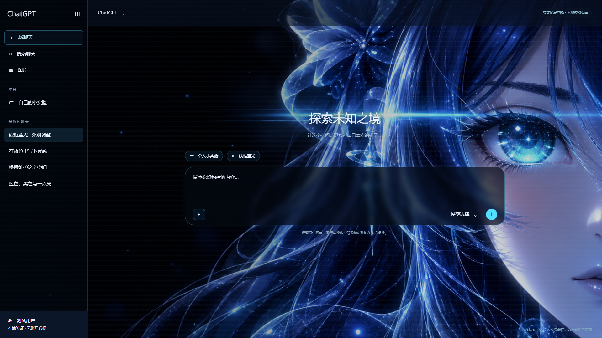

# 夜航 · ChatGPT 网页皮肤

个人使用的 Chrome 扩展，版本 **0.1.5**。用本机壁纸、青蓝色光效和半透明面板。代码包含中文注释。

## 加载与使用

1. 在 Chrome 中打开 `chrome://extensions`，开启开发者模式。
2. 选择“加载已解压的扩展程序”，定位到本仓库的 **chatgpt-nebula-extension** 文件夹，它直接包含 manifest.json。
3. 刷新 ChatGPT。打开夜航完整设置，选择“线框蓝光”，开启“动态效果”和“人物画面切换”。

人物切换固定 **10 秒一轮**：0–2 秒线框，2–4 秒渐变为人物，4–6 秒人物，6–8 秒回到线框，8–10 秒线框。新增开关默认关闭；升级保留已有选择。一键“应用原版风格”可以同时应用参考配色和透明度，但保留原总动态开关。

升级时沿用原加载目录，重载扩展并整页刷新网页，以继续使用原有设置与本机素材。也可从 releases 解压当前版本的运行包；不要把整个仓库根目录当作扩展加载目录。

## 目录

| 路径 | 内容 |
| --- | --- |
| chatgpt-nebula-extension/ | 可直接加载的插件源码、本机壁纸、设置界面 |
| chatgpt-nebula-extension/tests/ | 六类回归脚本、匿名 HTML 夹具和当前冻结报告 |
| docs/ | 规划、维护、10 秒效果说明、素材提示词和验证范围 |
| docs/assets/ | 设计图及模拟页面中的实际扩展渲染图 |
| tools/ | 打包、包内文件核对和材料整理工具 |
| releases/ | 0.1.5 当前运行包及 0.1.4 对照包 |

完整用法见 [扩展说明](chatgpt-nebula-extension/README.md)，开发测试见 [TESTING.md](TESTING.md)，修订历史见 [CHANGELOG.md](CHANGELOG.md)。最新证据见 [0.1.5 验证记录](docs/验证记录-0.1.5.md)，材料处理范围见 [上传材料说明](docs/上传材料说明.md)。

## 实现与验证范围

人物变化采用两张同构图静态壁纸叠化，运行时不调用模型。只使用 storage 权限；内容脚本匹配 chatgpt.com，背景在独立扩展 iframe 内绘制，不读取会话内容。自定义图片和视频留在本机。

演示图来自离线模拟页面，不是实际登录账号；测试通过不保证未来网页改版自动兼容。后台暂停通过可见性通知模拟，页面恢复使用合成事件。具体实测范围与限制写在验证记录中。
