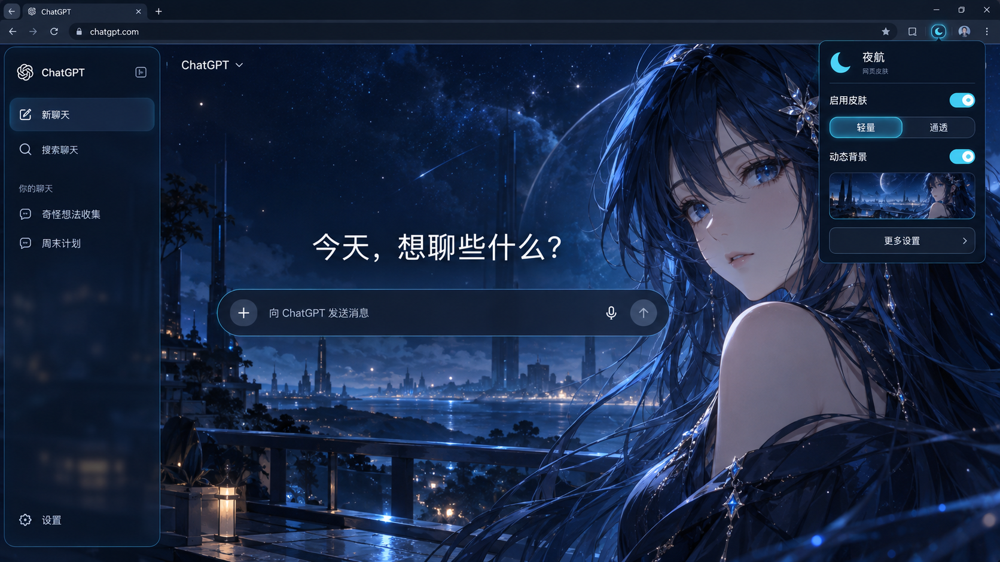

# ChatGPT 网页皮肤插件规划书

版本：v0.5（固定 10 秒与分享材料整理）
日期：2026-10-07；原规划日期：2026-10-06  
使用环境：Windows 上的 Google Chrome，ChatGPT 网页版  
阶段：规划、效果图与首版实现；浏览器验证范围另行记录  
名称：夜航 · ChatGPT 网页皮肤

## 1. 项目目标与用户约束

为自己使用的 ChatGPT 网页增加动态背景、半透明面板和少量青蓝色光效。参考附件中的 DeepSeek Harness 动图氛围，保留 ChatGPT 的聊天使用方式。

用户曾自行修改本地客户端，但在持续版本更新中约 20 天后失效，维护成本较高。用户随后明确表示愿意长期维护，并授权开始实现。项目仍按“聊天功能可用、文字可读、集中维护、视觉效果”的顺序处理；接受长期维护不等于扩大到模型接口或客户端改造。

用户确认采用 Chrome，并明确要求依次交付规划书、成品效果图，之后再实现插件；实现代码必须带注释。前两项已先行交付，此后按最新授权完成首版代码。代码注释用中文，用户现有 Chrome 资料未被安装或修改。

本规划不承诺长期零维护。ChatGPT 未在本次检索资料中提供稳定的整站皮肤接口，其网页结构、样式变量和浏览器行为均可能变化。工程目标是把变化的影响限制在薄的网页适配层，降低每次修补的范围。

## 2. 产品范围

### 第一版必需功能

| 功能 | 设计要求 | 默认行为 |
| --- | --- | --- |
| 启用开关 | 关闭后撤销插件添加的背景、属性和样式效果 | 启用 |
| 背景预设 | 提供无外部依赖的蓝色氛围背景 | 蓝色氛围 |
| 自定义背景 | 从本机选择 PNG、JPG、WebP、GIF、MP4 或 WebM | 未选素材时使用预设 |
| 背景调节 | 调节压暗程度和画面焦点位置，避免人物被裁掉 | 压暗 35%，焦点偏右 |
| 面板调节 | 调节不透明度与模糊程度，保持文字可读 | 不透明度 82%，模糊 8 px |
| 主题强调色 | 在颜色选择器中调整边框和选中状态的颜色 | 青蓝色 #76D9FF |
| 动态开关 | 可停止自身动画；视频暂停；GIF 切换为静态封面 | 动态开启，尊重系统减少动态设置 |
| 人物画面切换 | 线框预设中使用两张同构图壁纸，按固定 10 秒周期叠化 | 独立开关默认关闭；升级保留已有选择 |
| 两档适配 | “轻量”侧重稳定；“通透”增加局部面板效果 | 轻量 |
| 本地保存 | 设置和用户选择的背景留在扩展自己的本机存储中 | 自动保存 |
| 故障回退 | 素材加载失败时回退预设并提示；样式规则未命中时跳过该规则 | 基础背景仍可用，网页样式失配需人工检查 |

自定义素材暂设单文件 50 MiB 上限。这是首版的产品限制，不是 Chrome 的统一存储上限；导入失败时保留原背景，并显示可理解的错误。

### 暂不纳入第一版

实时三维人物、Live2D、根据回答改变表情、模型切换、额度统计、会话导出、云端同步和插件市场发布。这些功能会扩大验证与维护范围；当前任务集中于网页外观。

## 3. 视觉设计

### 整体方向

深海蓝底色，青蓝色细边框，轻微发光，留有暗部和空白。侧栏、聊天正文和输入框保持足够的对比度。角色壁纸主要分布在画面右侧，正文区域保留安静、压暗的背景。

规划不要求逐像素复刻参考录屏。附件已经包含 DSH 的侧栏、输入框和用量文字，整段直接当背景会形成两套界面。成品效果图采用干净的原创角色背景作为示例；首版已从设计图生成无界面的角色壁纸，作为「星夜角色」预设随包提供。

### 页面构成

| 区域 | 设计表现 |
| --- | --- |
| 浏览器区域 | 保留普通 Chrome 网页体验，地址为 chatgpt.com |
| 左侧栏 | 深蓝半透明，常规会话列表与导航保持清晰 |
| 正文区域 | 原有聊天内容居前，背景角色居后；正常滚动和选择文字 |
| 输入区域 | 深色玻璃面板，细青蓝边框，清晰的输入文字与原有按钮 |
| 扩展弹窗 | 主开关、轻量/通透、动态开关与“更多设置” |
| 详细设置页 | 本机选文件、背景压暗、焦点位置、面板不透明度、模糊、强调色与恢复默认 |

首张成品效果图展示“聊天主页 + 自定义角色壁纸 + 扩展弹窗”。静态图只能表现视觉方向，不能证明动态播放、安装成功或与真实 ChatGPT 页面兼容。图中的网页布局为设计示意，实际实现以安装时的网页结构为准。

成品效果图 v1 已完成：`assets/夜航-成品效果图-v1.png`。实际生成提示词记录于相邻文件 `成品效果图提示词.md`。

0.1.3 按用户再次提供的原版 GIF 添加「线框蓝光」：深黑左侧、右侧蓝色线框人物、细青蓝输入边和独立背景光效。人物为静态原创建图，光束与稀疏代码雨为 CSS 动态；不把含 DSH 界面的原 GIF 直接作为壁纸。原版 78 帧、约 5.87 秒，抽样帧、范围说明和真实扩展夹具截图见 `输入框与线框蓝光说明.md`。这次还修复了方形外表单描边与原生圆角内层分离的问题，不改正文宽度或原生圆角。

0.1.4 增加同构图有色人物 PNG，通过独立背景中的透明度动画实现「线框 → 人物 → 线框」。新开关默认关闭，一键参考风格明确开启它，但保留启停和总动态。两图按需解码且尺寸一致后才播放；关闭动态或系统减少动态时回到线框，后台通知暂停当前相位。该效果是两张静态图叠化，没有增加真实人物变形或 Live2D。实际渲染与最终 22 项新动态检查见 `人物双态背景说明-0.1.4.md`、`验证记录-0.1.4.md`。

## 4. 技术方案与证据

### 4.1 Chrome 扩展外壳

采用 Manifest V3。静态内容脚本仅匹配 `https://chatgpt.com/*`，在页面加载后运行，使用默认隔离执行环境，首版只请求 `storage` 权限。Chrome 官方文档支持这种按指定网页加载脚本与样式的方式，并说明隔离执行环境与网页脚本的变量相互独立。[Chrome 内容脚本文档](https://developer.chrome.com/docs/extensions/develop/concepts/content-scripts)

该隔离仅针对 JavaScript 执行环境；脚本对页面 DOM 的修改仍然作用于同一网页。因此隔离本身不意味着网页结构可以随意改写，也不意味着所有媒体加载都自动不受网页策略影响。

### 4.2 独立背景层

实现使用扩展自己的背景页面，由轻量内容脚本挂载到网页背后。媒体播放、预设动画和素材读取留在扩展页面中。背景层不接收鼠标点击，不进入键盘焦点，不替换聊天控件。具体机制在真实 Chrome 的离线网页夹具中测试；该夹具测试不能代替真实账号网页的完整验证。

嵌入的扩展页面采用扩展自己的内容安全策略；Chrome 官方文档明确将扩展创建的 iframe 页面列入 extension pages 策略适用范围。[Chrome 扩展内容安全策略](https://developer.chrome.com/docs/extensions/reference/manifest/content-security-policy)

背景入口 `backdrop.html` 声明为网页可访问资源，只向 ChatGPT 指定源开放；其他资源在扩展页面内部加载。[Chrome 网页可访问资源文档](https://developer.chrome.com/docs/extensions/reference/manifest/web-accessible-resources)

### 4.3 设置与媒体保存

小型设置存入 `chrome.storage.local`，用户导入的图片和视频 Blob 存入扩展源的 IndexedDB。Chrome 官方文档说明内容脚本直接使用网页存储会访问宿主网页的存储，而扩展页面之间可共享扩展源存储；嵌入网页的 `chrome-extension://` 页面享有文档所述的存储分区例外。因此媒体应由扩展页面管理。[Chrome 存储与 Cookie 文档](https://developer.chrome.com/docs/extensions/develop/concepts/storage-and-cookies)

不将大 GIF 或视频编码为字符串塞进设置存储。官方资料列出的 `storage.local` 默认限额为 10 MB，媒体采用独立存储方案更适合。[Chrome Storage API](https://developer.chrome.com/docs/extensions/reference/api/storage)

本方案不要求读取会话内容、Cookie、账户凭据或模型接口。个人壁纸无需远程上传，内置代码和资源随扩展打包。

### 4.4 网页样式适配

独立背景和网页适配分别实现。适配文件集中保存需要依赖 ChatGPT 的颜色变量与少量语义选择器，每一组规则标注用途、依赖点和失配后的结果。

“轻量”优先调整基础配色与有限透明效果。“通透”额外增强能够可靠定位的侧栏、顶部和输入面板。无法识别结构时，放弃对应增强。两种模式都避免更改网页布局尺寸、滚动容器、编辑器内容、按钮行为和 React 状态。

这些策略属于降低耦合的工程设计，不是 OpenAI 对第三方皮肤兼容性的承诺。两档实际效果和可回退程度要用真实网页验证。

## 5. 低维护约束

1. 不依赖压缩后的随机类名、固定层级链、中文或英文按钮文案。
2. 不修改 React 状态、网页接口请求、登录状态和会话数据。
3. 不监听整棵网页 DOM 的每次变化，不在流式回答时反复扫描页面。
4. 若需要恢复被移除的背景，只监听必要的顶层节点并节流。
5. 网页适配集中在一个文件；背景、设置、媒体存储分别独立。
6. 不使用构建框架、远程脚本和自动运行的模型请求；运行插件本身不调用 GPT。
7. 插件停用后应撤销自身注入，不依靠刷新才能恢复外观。
8. 更新后先评估降级状态是否仍可使用，再决定是否修补局部适配。

不能保证所有未来改版都自动适配，也不能保证同时保持原图级透明效果和完全无需维护。遇到二者冲突时，依照已明确的优先级降低视觉效果，保留可用性。

## 6. 性能与动态控制

仅使用一个背景层，采用低频 CSS 动画或本机媒体播放。页面不可见时停止自身 CSS 动画和视频播放；重新可见时遵循用户动态开关。

GIF 暂停采用静态封面替换，不能把“隐藏图片”当作暂停完成。用户系统偏好减少动态时，默认使用静态表现。模糊和动画强度提供调节，不将高强度模糊设为必要效果。

图片或视频解码失败、浏览器自动播放受限、存储配额不足都需要处理；失败时保留原素材或切回可靠预设，不能让聊天页面不可操作。

## 7. 代码注释规范

所有实现代码带有有用的注释。注释重点解释目的、维护边界、浏览器限制和失败处理，使用中文。

| 位置 | 注释内容 |
| --- | --- |
| 文件开头 | 文件职责、依赖、是否依赖 ChatGPT 页面结构 |
| 配置与存储 | 默认值、范围校验、版本字段和保存方式 |
| 网页适配 CSS | 每组选择器的作用、依赖的页面特征、失配后如何处理 |
| 背景层挂载 | 堆叠顺序、点击穿透、键盘焦点和清理逻辑 |
| 媒体逻辑 | Blob 地址释放、静态封面、暂停与恢复条件 |
| 异常分支 | 触发条件、回退行为、对用户显示的状态 |
| 必要兼容处理 | 对应官方资料及验证环境 |

JSON 文件不加入非法注释；`manifest.json` 的字段说明写入相邻说明文档。注释不逐行重复代码含义，不掩盖尚未验证的假设。

## 8. 实施顺序与交付物

| 阶段 | 工作 | 交付物 |
| --- | --- | --- |
| 1. 规划 | 明确目标、范围、技术路线和验收 | 本规划书 |
| 2. 成品效果设计 | 制作参考风格的静态效果图 | 设计图、生成提示词和图像用途说明 |
| 3. 扩展实现 | 按选定设计写带注释的代码 | 可加载的 Chrome 扩展目录、安装说明 |
| 4. 本地验证 | 检查配置、媒体、暂停、关闭与失配 | 验证记录与必要截图 |
| 5. 真实网页验证 | 在用户的 Chrome 和 ChatGPT 页面验证 | 真实页面兼容性结论、修补或回退记录 |

阶段 1、2 已先行完成；阶段 3 已实现。阶段 4 的实际结果见 `验证记录.md` 和机器可读测试结果。阶段 5 留待用户加载后的登录网页确认，不将离线夹具结果表述为真实账号网页已通过。

## 9. 首版验收标准

- 只在指定 ChatGPT 网页生效，在其他网页不注入。
- 能启停皮肤；停用后没有遗留背景层、样式属性或阻塞点击的元素。
- 新会话、发送、停止生成、会话切换、附件选择、复制、代码块、滚动和菜单保持可用。
- ChatGPT 设置弹窗及长回答文字保持可读，不出现全局透明导致的菜单文字叠加。
- 本机背景可导入、重开页面后可恢复；失败有明确提示且不损坏原配置。
- 视频暂停、GIF 静态封面、系统减少动态和后台暂停可验证。
- 模拟未命中适配选择器时，背景或配色可以降级，聊天功能保持可用。
- 浏览器网络检查中没有插件主动发出的远程资源或模型请求。
- 注释覆盖文件职责、关键适配规则、媒体生命周期和错误回退。
- 提供易读的加载、关闭、更新和素材更换说明。

## 10. 证据范围与未验证事项

本规划检索并实际读取 Chrome 官方内容脚本、存储、资源暴露和内容安全策略文档。部分文档发布较早，目前仍由官方站提供；其描述的存储分区规则适用于 Chrome 115 起的相应环境。本机测试 Chrome 版本为 154.0.8037.98；真实账号的 ChatGPT DOM 尚未直接验证。

已确认的是官方机制以及测试记录明确通过的行为。真实 ChatGPT 页面样式适配、所有媒体编码兼容性与账号完整功能回归仍需在对应环境验证。成品效果图仅用于视觉评审；实现截图另行标为离线夹具中的实际渲染。

## 0.1.5 分享准备

按用户要求将人物切换固定为 10 秒一轮，并整理独立 GitHub 材料目录。上传目录仅放插件源码、可配置的测试脚本、说明、提示词、当前验证资料和发布包；浏览器测试资料、签名私钥、原参考界面截图及其他项目文件留在本机。旧版本和原文件保留。
