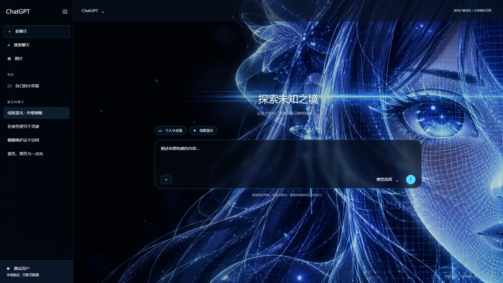

# 线框蓝光素材生成记录

日期：2026-10-07。使用内置 ImageGen，新生成不透明壁纸；附图只作为风格与构图参考，不是移除界面的编辑模式。人工查看生成结果后复制到扩展，不删除原输出或原壁纸。

参考为用户上传的 `EFA0F059C6080971D4823D310FAABAD1.gif` 的第 0 帧。GIF 宽高 1920×1078、78 帧、总时长 5870 ms，抽样帧与元数据在 `assets/reference-inspection/`。第 39 帧约 2930 ms 处出现有色人物与代码雨，说明原动画不是全程静止线框。

本次要求把界面、侧栏、额度文字和品牌排除在生成图像之外，仅参考深黑左侧、右侧线框人物近景、青蓝横向光束和粒子。交付图为 **1672×941 PNG**，文件 `../chatgpt-nebula-extension/assets/wireframe-wallpaper.png`。它是静态图；运行时的网格、光束扫动和稀疏代码雨由独立背景页 CSS 绘制，不是人物自身变形或原 GIF 的逐帧复刻。

原始生成输出：`<本机生成输出路径已省略>`。参考帧只作为本项目检查记录保留，不打包到扩展。

## 实际提交提示词

```text
Create a NEW original desktop wallpaper inspired by the supplied reference's visual language and composition. The reference is a style/composition reference ONLY, do not copy its application UI, logos, text, panels or controls. Landscape panoramic wallpaper 16:9, ideally 1920x1080 or larger. A blue-black futuristic anime portrait of an adult woman occupies the RIGHT 48% of the composition, closely cropped eye, cheek, long flowing hair, small futuristic ear adornment. Face and hair are drawn as luminous fine cyan/electric-blue 3D wireframe mesh contours with elegant precise geometry, subtle translucent shaded dark-blue volumes, very bright white-cyan eye highlight, a thin horizontal cyan beam passing through the eye towards the left, restrained glow. Keep the LEFT 52% nearly pure black, smoothly fading into deep navy, deliberately very sparse and quiet for readable app content; only a few small faint stars at its far edges. Strong asymmetrical close-up portrait on right, beautiful cybernetic hologram appearance, not cityscape, no buildings, no interface. Fine mesh/grid concentrated on portrait and right edge, tiny soft blue particles, deep black negative space, crisp delicate lines. No text, lettering, watermark, brand, sidebar, border frame or UI widgets. No extra characters. This is a finished clean background asset that will sit beneath a translucent web UI, no baked app interface. Preserve dark readable left half and visually impressive wireframe right portrait as mandatory. Opaque background.
```

请求目标是 1920×1080 或更大；工具实际返回尺寸为 1672×941。记录实际尺寸，不把提示词请求值写成已交付值。未进行像素级后期编辑或额外放大。运行背景按视口比例使用 `object-fit: cover` 与用户可调焦点；不同窗口比例会裁切画面。

## 成品渲染

以下为 Chrome 加载实际扩展的本地模拟页面，不是当前登录账号或原版 DSH 界面：


