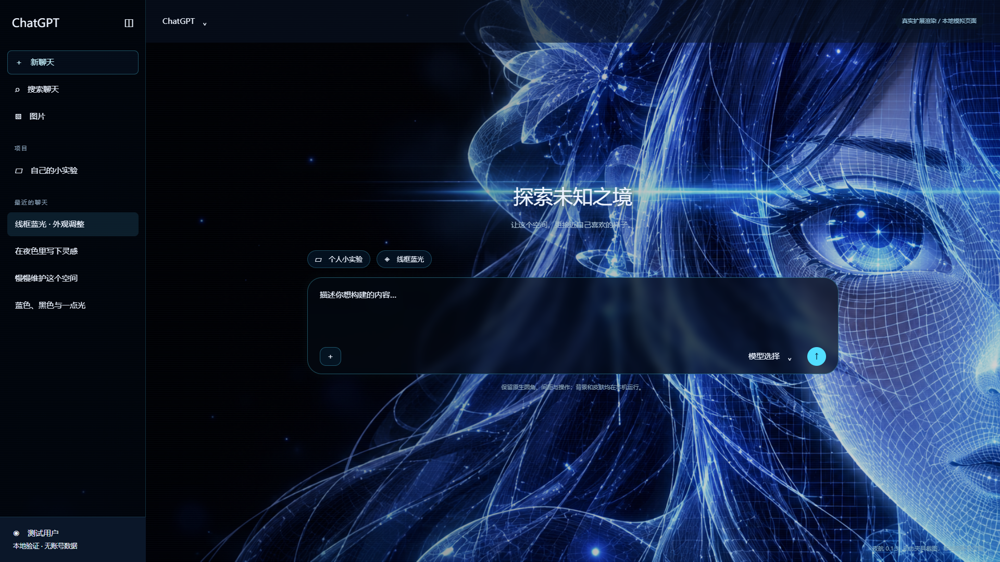
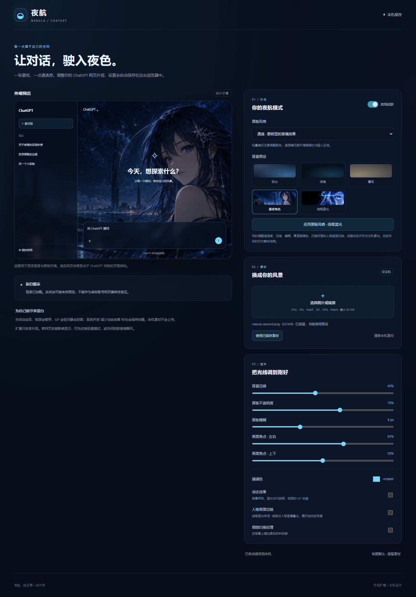

# 夜航 0.1.5 验证记录

日期：2026-10-07。Chrome **154.0.8037.98**，独立测试资料目录，真实加载 Manifest V3 扩展。网站由本机 HTML 夹具提供，没有使用真实账号。

本次按用户要求将人物切换改为固定 **10 秒一轮**，并整理 GitHub 分享材料。动画比例、开关和媒体清理行为沿用 0.1.4；没有重新生成图片。

## 本轮实际执行

本轮 **79 项浏览器检查通过**，6 份运行 JavaScript 与 6 份测试脚本语法检查通过。计数只包含本轮实际执行，没有把 0.1.4 的完整回归数当作本版重新执行结果。

| 检查 | 项数 | 冻结报告 |
| --- | --- | --- |
| 固定 10 秒、真实播放、动态控制与加载生命周期 | 23 | [dynamic-wireframe-results-0.1.5.json](../chatgpt-nebula-extension/tests/dynamic-wireframe-results-0.1.5.json) |
| 加载、设置、PNG/GIF/WebM、存储与恢复 | 19 | [results-0.1.5.json](../chatgpt-nebula-extension/tests/results-0.1.5.json) |
| 匿名 Work 夹具、输入表面和保护区域 | 37 | [work-results-0.1.5.json](../chatgpt-nebula-extension/tests/work-results-0.1.5.json) |

动态检查从真实浏览器动画实例读取到 `timing.duration = 10000` 毫秒。第 1、3、5、7、9 秒取样时，有色叠层透明度分别为 **0、0.5、1、0.5、0**，线框底图始终为 **1**；自然时间推进另行测量。周期为 0–2 秒线框、2–4 秒转人物、4–6 秒人物、6–8 秒回线框、8–10 秒线框。

同一套动态检查继续覆盖图片真实解码、减少动态、开关和一键风格、加载中修改亮度、减少动态与解码完成竞态、换素材后的旧回调、叠层失败静态降级、底图失败极光降级、清除旧故障提示、停用与恢复及原生输入操作。

Work 夹具将维护者昵称替换为“示例用户”，重新运行 37 项检查通过。测试依赖不再使用个人 Codex 缓存路径 fallback，加载和媒体回归在显式提供本机既有库路径后通过。本次没有安装依赖。

六份运行脚本、测试脚本语法和运行文件哈希见 [syntax-results-0.1.5.json](../chatgpt-nebula-extension/tests/syntax-results-0.1.5.json)。各次原始浏览器输出未出现脚本错误或夹具之外的主动远程请求；故障注入中主动阻断壁纸资源，清理路径中取消旧请求。

最终背景 CSS SHA-256：`ee55ea7d9849c9634a0f24d3093ee57ec3c9e4da7a37792b0633cbcd487ec62a`。网页适配 CSS 及背景 JavaScript 沿用 0.1.4，本次仅修改动画周期、版本及说明。

## 实际渲染

以下是本机 Chrome 加载扩展后的离线模拟页面。人物和线框截图通过动画相位采样取得，不能仅凭静态图证明自然播放；自然推进是单独检查。

## 发布和分享副本

当前运行包：[夜航-Chrome-0.1.5.zip](../releases/夜航-Chrome-0.1.5.zip)。21 个运行文件与源码逐个 SHA-256 核对一致，manifest 位于包根部，版本为 0.1.5。包大小和哈希以 [release-0.1.5.json](../chatgpt-nebula-extension/tests/release-0.1.5.json) 为准。

原工程保留 0.1.0–0.1.4 的全部旧包。分享目录附带当前包及 0.1.4 对照包；发行报告的历史保留检查来自原工程，`expectedPreviousVersions` 明确记录其范围，不表示分享目录附带全部历史包。

分享目录中的报告仅归一化本机路径，断言、数值、版本、时间及运行文件哈希保留。原始 profile、临时 run 和故障诊断留在原工程；文件清单见 `整理清单.json`。本次只在本机整理，没有 GitHub 上传或推送。

## 仍需实机确认

headless 切换标签没有产生真实 `document.hidden`；后台暂停通过受限可见性通知模拟验证。`pagehide/pageshow` 使用合成事件，不证明真实 BFCache 命中。本次没有测量后台 CPU/GPU 占用。

实际账号 DOM、缩放、其他扩展混用及完整真实聊天流程仍需加载后核对。人物变化采用两张静态图叠化，没有实现 Live2D 或原参考 GIF 的逐帧复刻。
